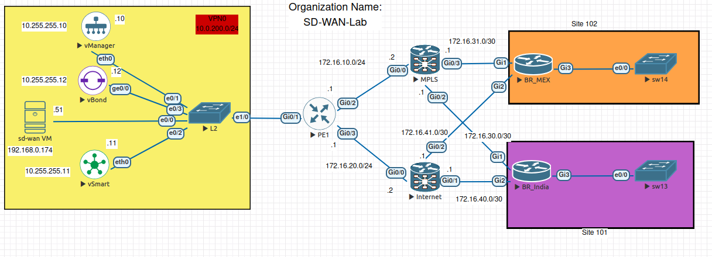

# AI-Assisted Network Automation Lab

An experimental network automation lab built with Proxmox, EVE-NG, Python, Ansible, and Cisco SD-WAN.

The project explores how **AI, network telemetry, and automation** can work together to improve network visibility, troubleshooting, and operational efficiency. The initial focus is Cisco SD-WAN, with an architecture intended to support broader network automation experiments over time.

## Objectives

- **Network automation:** Automate repetitive tasks through APIs, Python, and Ansible.
- **Telemetry and observability:** Collect and analyze network state, device health, events, and operational data.
- **Topology awareness:** Build an understanding of network devices, links, routing, and dependencies.
- **AI-assisted troubleshooting:** Use locally hosted language models to interpret telemetry, correlate symptoms, and help identify root causes.
- **Controlled remediation:** Explore AI-assisted corrective actions with validation and safeguards.
- **Reproducible experiments:** Use virtual network environments to simulate failures, test hypotheses, and evaluate automation workflows.

## Lab Environment

| Component | Details |
|---|---|
| Virtualization | Proxmox VE |
| Network emulation | EVE-NG |
| SD-WAN controllers | Cisco SD-WAN 20.9.1 |
| Branch routers | Cisco C8000V, IOS XE SD-WAN 17.6.3a |
| Automation VM | Ubuntu Linux |
| Automation tools | Python 3.10, Ansible 2.17 |
| AI platform | Local LLMs with Ollama planned for integration |

## Lab Topology

| Device | IP address | Role |
|---|---|---|
| vManage | `10.0.200.10` | Management and REST API |
| vSmart | `10.0.200.11` | Control plane |
| vBond | `10.0.200.12` | Orchestration |
| Automation VM | `10.0.200.51` | Python and Ansible |
| BR_IN | `10.255.1.1` | Branch router, site 101 |
| BR_MEX | `10.255.1.2` | Branch router, site 102 |

## Current Implementation

- Authenticate to the vManage REST API.
- Retrieve device inventory and controller information.
- Retrieve and decode device running configurations.
- Save API results and configuration output for analysis.
- Maintain automation code and lab workflows in version control.
- Establish and verify SD-WAN overlay connectivity between branch sites.

## Planned Development

### 1. Network Automation

Extend the Python API client and Ansible workflows to automate service VPNs, branch configuration, device onboarding, and configuration deployment.

### 2. Telemetry and Topology Awareness

Collect operational data and develop a network model that represents devices, links, routing relationships, and service dependencies.

### 3. AI-Assisted Network Operations

Integrate locally hosted LLMs through Ollama and an appropriate orchestration layer. Provide relevant topology and telemetry context so the AI can assist with state analysis, fault isolation, and root-cause investigation.

### 4. Validation and Remediation

Build repeatable failure scenarios in EVE-NG. Evaluate proposed corrective actions, validate their expected effects, and explore controlled execution with safeguards and post-change verification.

### 5. Documentation and Reproducibility

Document experiments, automation workflows, failure scenarios, and results. Share reusable code and findings through GitHub.

## Project Structure

```text
SD-WAN-Automation/
├── ansible/             # Ansible automation
├── output/              # Generated API results and configurations
├── pki/                 # PKI-related lab files
├── python/
│   └── vmanage/
│       ├── client.py    # vManage API client
│       └── test_client.py
├── .env                 # Local credentials (not committed)
├── .gitignore
└── README.md
```

## Security and Operational Safety

- Store credentials in a local `.env` file.
- Never commit credentials, session cookies, private keys, or other secrets.
- Use trusted certificates and enable SSL verification outside the lab.
- Treat AI-generated diagnoses and configuration changes as proposals until validated.
- Use explicit safeguards, change validation, and post-change checks when testing automated remediation.

## Project Status

This is an active research and learning project. Basic vManage API authentication, inventory retrieval, configuration collection, and SD-WAN overlay validation are working. Broader telemetry integration, AI-assisted analysis, and controlled remediation are development goals.

The long-term objective is to explore a network operations workflow in which **telemetry provides context, topology provides relationships, AI assists with reasoning, and automation executes validated actions**.

## Lab Architecture



